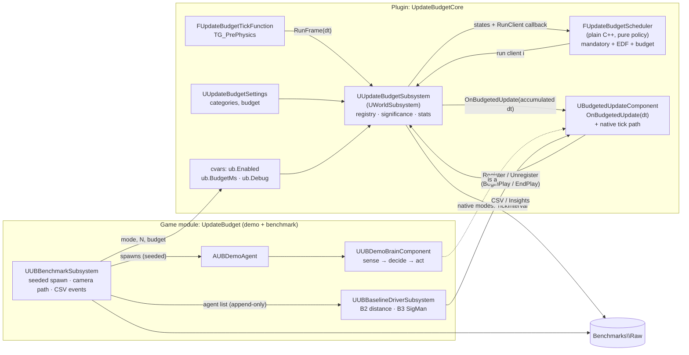
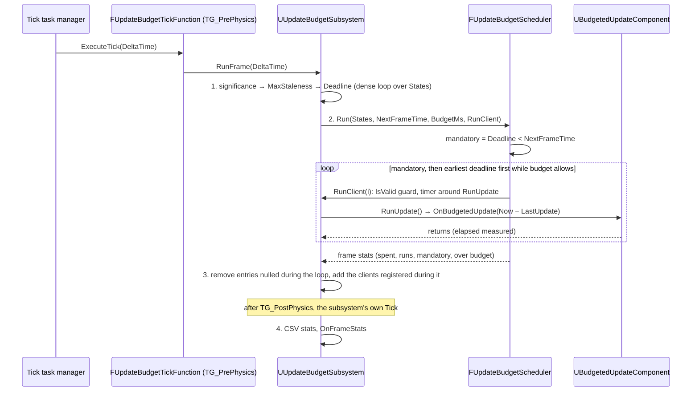

# 02 · System Architecture: UpdateBudget (v1.0, final)

**Phase:** 3 (Architecture), **final**, 2026-11-20. It replaces the initial draft from Step 0, whose changes are listed in §13.
**Engine:** UE 5.8.4. Every engine behaviour relied on here is verified in [01b_Research_Findings.md](01b_Research_Findings.md); references like `01b #3` point to its §1 table.
**Rule:** this is the design *before* code (Phase 3). If implementation proves a decision wrong, this file is updated in the same step.

---

## 1. Goals and non-goals

**Goals**
1. Keep the game-thread time spent on budgeted gameplay updates near a configured ms budget.
2. Spend that budget where it matters: significant agents are allowed less staleness.
3. **Hard guarantee:** no agent goes un-updated for longer than its staleness limit plus one frame.
4. Give each update the **accumulated** delta since its last update, matching what the engine gives interval ticks (`01b #4`).
5. Switch live between native ticking and budgeted ticking **in the same build**, with an identical workload.
6. Keep the core reusable (a plugin) and its scheduling logic **testable without a world**.

**Non-goals (v1)**
- Replacing Mass (that is P9).
- Running gameplay logic on worker threads.
- Budgeting animation (the Animation Budget Allocator does that).
- Dedicated-server relevance from many player views (a growth path, §11).
- Respecting per-actor tick prerequisites (a documented limit, §12).

## 2. The core idea in plain words

Every registered agent has a **deadline**: the latest time it may next be updated.

```text
Deadline = LastUpdateTime + MaxStaleness(Significance)
```

- **Significance** comes from distance and view direction. A near, visible agent gets `MaxStaleness ≈ 0`, so its deadline is always *now*. A far agent gets up to 0.5 s.
- **Every frame:**
  1. Run every agent whose deadline falls before the next frame. These are **mandatory**: this is the no-starvation guarantee, and it beats the budget.
  2. Then run the rest in **earliest-deadline-first** order until the predicted cost of the next update would exceed the remaining budget.

Earliest-deadline-first (EDF) is a classic real-time scheduling rule. Our case fits **Jackson's rule**: all work is available at the start of the frame, and updates are not interrupted part-way. In that case, running jobs in deadline order minimises the worst lateness of any job. This is the textbook result that justifies the choice. The budget cut-off is our own addition, and the measurements (SC1–SC3) show how it behaves.

**Rejected alternatives:**

| Alternative | Why we rejected it |
|---|---|
| Sort by significance only | Far agents starve forever under load |
| Round-robin | Ignores relevance: a guard in your face waits its turn |
| Hand-tuned priority = significance × age | Works, but needs extra weights to tune. EDF gives one meaning to significance: "how long may this wait?" |

## 3. Modules and where they live

```text
D:\UNREAL PORTFOLIO\P01_UpdateBudget\UpdateBudget\          ← the UE project
├── UpdateBudget.uproject
├── Source\UpdateBudget\{Public,Private}\                    ← game module: demo + benchmark only
├── Plugins\UpdateBudgetCore\Source\UpdateBudgetCore\{Public,Private}\   ← the reusable system
└── Config\  Content\
D:\UNREAL PORTFOLIO\P01_UpdateBudget\Tools\                  ← Python stats + run scripts (not part of the UE project)
```

| Module | Type | Responsibility | Depends on |
|---|---|---|---|
| `UpdateBudgetCore` (plugin) | Runtime | Scheduling policy, registry, tick function, settings, cvars, telemetry | `Core`, `CoreUObject`, `Engine`, `DeveloperSettings` |
| `UpdateBudget` (primary game module) | Game | Demo agents, workload spawner, baseline drivers (B2/B3), benchmark director | `UpdateBudgetCore`, `SignificanceManager` (B3 only) |
| `Tools\` | Python | CSV statistics (median, p95, p99), correctness comparison, run orchestration | — |

**The dependency rule:** game → plugin, never the reverse. The plugin knows nothing about agents, baselines or benchmarks.

**Naming:** the plugin is `UpdateBudgetCore` because module names must be unique ([research/04](Research/04_local_engine_verification.md) §0). Public headers use 5.8's export convention: `#define UE_API UPDATEBUDGETCORE_API` … `#undef UE_API` (`01b` §3).

## 4. Classes

### 4.1 Plugin `UpdateBudgetCore` (6 pieces, each with a reason)

| Class | Kind / base | Responsibility | Why it exists, and what we rejected |
|---|---|---|---|
| `FUpdateBudgetScheduler` | Plain C++ struct (no UObject) | The **policy**: given client states, the time, the budget and a "run client *i*" callback, it decides who runs and returns frame stats | Makes the algorithm **unit-testable with fake clients and fake costs, without a world**. *Rejected:* logic inside the subsystem, which can only be tested in a running world |
| `FBudgetClientState` | Plain struct | The hot data per client. S4 added the two fields the policy reads, `Deadline` and `CategoryIndex`. **S5 adds `LastUpdateTime`**, mirrored from the component by `RecordUpdate` in every mode, so the deadline loop never reads the component. **S6 adds `Significance`** (not the planned `MaxStaleness`: nothing reads the max staleness once the deadline is set, while SC3 needs "near", which significance gives directly; it fills padding, so the struct stays at 24 bytes) | The per-frame loop walks this dense array and touches no UObject memory (H5) |
| `UUpdateBudgetSubsystem` | `UTickableWorldSubsystem` | The **mechanism**: registry, significance refresh, owning the tick function, running the scheduler, telemetry, mode switching. **S5:** reads the mode (`ub.Enabled`) once in `OnWorldBeginPlay`, applies it to every client, registers the tick function, and defers registry changes made while the scheduler runs | Its lifetime is the world. Its own `Tick` runs after `TG_PostPhysics` (`01b` §2), which is the right moment to publish one frame's complete telemetry. Scheduling uses the separate `TG_PrePhysics` tick function below. *Rejected:* a manager Actor (can be deleted or duplicated); `UGameInstanceSubsystem` (outlives worlds) |
| `FUpdateBudgetTickFunction` | USTRUCT deriving `FTickFunction`, with `WithCopy = false` | Calls `Subsystem->RunFrame(DeltaTime)` in **`TG_PrePhysics`** | `UTickableWorldSubsystem` ticks after `TG_PostPhysics` and can't choose a group (`01b` §2). A world-level owner of a `TG_PrePhysics` tick function registered on the persistent level is what Mass does ✔ (`MassProcessingPhaseManager.cpp:485–486`). **Checked in S5:** Mass's `FMassProcessingPhase` is a plain struct with deleted copy operations in 5.8.4 (`MassProcessingPhaseManager.h:54–60`); the USTRUCT form with `WithCopy = false` is the engine's own `FActorTickFunction` (`EngineBaseTypes.h:565–608`) and Niagara's world-manager tick function (`NiagaraWorldManager.h:47–69`) |
| `UBudgetedUpdateComponent` | `UActorComponent` | The client. It holds the category, registry index and last update time, and declares `virtual void OnBudgetedUpdate(float DeltaSeconds)`. It also has a **native-tick path** for the baselines. It **owns the time contract**: `DeltaSeconds` = world time since its previous update (0 on the first), measured the same way in every mode; the engine's tick `DeltaTime` is not forwarded. **S5:** it joins the registry in `BeginPlay` (and `OnRegister` when re-registered while playing) and leaves in `OnUnregister` or `EndPlay`, whichever comes first: the moments the engine registers and unregisters its native tick. In budgeted mode its native tick is off, and a guard in `TickComponent` turns it off again if other code turns it on | A component, not an interface: it must hold data and attach to any actor, Blueprint actors included. *Rejected:* an interface (every class re-implements the bookkeeping); a per-actor delegate (binding plus indirect-call cost in the hot loop) |
| `UUpdateBudgetSettings` + `FUpdateBudgetCategory` | `UDeveloperSettings` (`config=Game, defaultconfig`) + USTRUCT | Project Settings: budget ms and categories (near/far distance, near/far max staleness, out-of-view multiplier), **read once per world** in `OnWorldBeginPlay` (S6). The significance maths live on the category and on `FUpdateBudgetView`, in their own header, so they are unit-tested without a world. *Dropped in S6:* a tick-group setting, because the native baselines tick in `TG_PrePhysics` and a configurable group would let the two drift apart | One config-backed, designer-editable place. *Rejected:* `UDeveloperSettingsBackedByCVars`, whose sync is editor-only (`01b #11`); Data Assets, which add a loading step for no gain yet |

**Console variables** (`ECVF_Default`, because cheat flags can't be set from config, `01b #11`):

| Cvar | Meaning |
|---|---|
| `ub.Enabled` | `0` native, `1` budgeted. **S5:** read once per world, in `OnWorldBeginPlay`. **S7:** a later change switches every running world at the end of the next frame that ticks actors (§8). A run starts budgeted with `-ini:Engine:[ConsoleVariables]:ub.Enabled=1`, because `-ExecCmds` run only after the world has begun play (§13) |
| `ub.BudgetMs` | Override the settings value; `<0` means use the settings value |
| `ub.Debug` | Debug draw and on-screen stats |

**Telemetry** (as built in S6):
- A stats group `STATGROUP_UpdateBudget` with cycle stats `RunFrame` and `Deadlines`.
- A CSV category `UpdateBudget`. In every mode: `Clients`, `UpdatesRun`, `MaxGapMs`. In budgeted mode only: `UpdateMs` (measured update costs), `BudgetMs`, `MandatoryRuns`, `MandatoryMs` (the mandatory updates' cost; above the budget, the overrun was forced), `Deferred`, `OverBudget` (0/1), `NearClients` and `NearMissed` (SC3). Timing scopes `UpdateBudget/GameThread/RunFrame` (the whole budgeted path) and `.../Deadlines` (the significance loop). Metadata `UBMode` and `UBMaxStaleness` (the run's SC2 bound). **`NearMaxGapMs` became `NearClients` + `NearMissed`** (§13).
- One native multicast delegate `OnFrameStats` (S7), with the same frame report the CSV gets (`FUpdateBudgetFrameReport`).

### 4.2 Game module `UpdateBudget` (4 classes)

| Class | Base | Responsibility |
|---|---|---|
| `AUBDemoAgent` | `AActor` | A mesh plus one brain component. Nothing else |
| `UUBDemoBrainComponent` | `UBudgetedUpdateComponent` | The workload: sense (distance and cone vs player) → decide (patrol/alert/return state machine) → act (move along a patrol loop driven by **accumulated patrol time**, so the correct position is known exactly) → a calibrated compute step |
| `UUBBaselineDriverSubsystem` | `UTickableWorldSubsystem` (Game/PIE) | Baselines B2 (distance → `TickInterval`) and B3 (Significance Manager → `TickInterval`), selected with `-UBBaseline=B2\|B3`. Ticks right after the benchmark subsystem (`InitializeDependency`), adopts its agents by index (the agent list is append-only), and maps both baselines through **one shared band test**. **Times its own work** (`Register`, `Retune`) and counts interval changes, to test H6 (S3) |
| `UUBBenchmarkSubsystem` | `UWorldSubsystem` (Game/PIE) | The benchmark director. Reads `-UB…=` values and spawns N agents from a fixed seed (deferred spawn, so the patrol is set before `BeginPlay`). From S2: moves the camera along a fixed analytic path, triggers the doubling wave, fires `CSV_EVENT(BenchStart)` after warm-up, writes CSV metadata and dumps final positions. **Changed in S1:** the project has no hand-authored map, so nothing would place a director or spawner actor. A world subsystem has exactly the right lifetime and replaces both planned actors |

## 5. Overview diagram



## 6. Per-frame flow



**S5 notes.** Between frames, `Register` and `Unregister` change the arrays at once; only changes made *during* step 2 are deferred to step 3 (the policy reads `States` through a raw pointer, so nothing may reallocate it). Until S6 adds significance, step 1 uses a max staleness of 0 for every client: every client is due every frame, so the scheduler path does exactly the native path's work, which is what makes S5 checkable against B0 (09, S5).

**S6 notes.** Step 1 reads the player camera's cached view once, then per client: the owner's location, significance from distance and view (`FUpdateBudgetCategory::GetSignificance`, `FUpdateBudgetView::IsInView`), max staleness, deadline. Without a camera every client keeps significance 1. After step 3's removals, one dense pass counts near clients and those not updated (SC3), and the subsystem's `Tick` publishes the frame.

### Policy, in code-sized pseudocode (the real code mirrors this)

```text
Order = all clients sorted by (Deadline, index)            // v1: full sort; Phase 8 may replace it with data
NumMandatory = count of the prefix with Deadline < NextFrameTime   // waiting a frame would break the bound
for k, i in Order:
    if k >= NumMandatory and Spent + Predicted[Category[i]] > Budget: break   // don't start work that won't fit
    Cost = RunClient(i)                                     // measured; negative or non-finite counts as 0
    Predicted[Category[i]] += Alpha * (Cost - Predicted)    // EWMA, like the ABA's smoothed work-unit cost
    Spent += Cost                                           // mandatory runs may overrun the budget: counted
```

One sort gives both sets: after sorting, the mandatory clients are exactly the prefix due before the next frame, so mandatory clients also run most-overdue first. The code is `FUpdateBudgetScheduler::Run` (S4, 05 Part E).

`NextFrameTime = Now + DeltaTime`. The last frame's delta is used as the estimate. In fixed-step runs it is exact.

## 7. Defaults and why

| Setting | Default | Reasoning |
|---|---|---|
| `BudgetMs` | 2.0 ms | About 12% of a 60 fps frame (16.67 ms), leaving room for physics, animation and UI. The benchmark sweeps 1, 2 and 4 ms |
| Near / far distance | 15 m / 60 m | The demo arena scale. Tunable per category |
| Near max staleness | 0 s | What the player is looking at never stutters |
| Far max staleness | 0.5 s | Within human-like reaction times; usually invisible at distance. Expressed in **seconds**, so it doesn't depend on frame rate (`01b` §5) |
| Out-of-view multiplier | 0.5 on significance | Agents outside the camera's view may be staler, but are not frozen. **Renamed in S6** from "behind-camera": an agent 80° to the side is as invisible as one behind |
| View cone | Half-angle to the screen's corners, from the horizontal FOV and aspect ratio | Nothing on screen counts as out of view; a little just above and below the screen does, which errs towards freshness (S6 code review) |
| Always-in-view radius | 2 m from the camera | The player's own pawn and anything touching it are never treated as out of view (S6 code review) |
| Tick group | `TG_PrePhysics` | The same group as the native baseline component (`01b #1`) |
| Cost smoothing | EWMA α = 0.2 | Reacts within a few frames without jitter. Measured and revisited in Phase 8 |

## 8. Lifetime and safety rules

| Risk | Rule | Evidence |
|---|---|---|
| The tick function runs in editor worlds | `DoesSupportWorldType`: Game and PIE only. Register in `OnWorldBeginPlay` | `01b #2` |
| The tick function outlives the subsystem | Unregister explicitly in `Deinitialize` (the destructor also unregisters, as a safety net) | `01b` §2 |
| A component is destroyed but its reference is still non-null | Unregister in `EndPlay`. `IsValid()` guard in `RunClient`. Null and invalid entries removed after the loop, and after every garbage collection in every mode (S5 code review: before that, a native-mode registry kept a slot GC had nulled) | `01b #8`; `UObjectGlobals.h:3490` |
| A component is added or destroyed **during** another update | A `bRunningScheduler` flag defers both: a removal nulls the slot, an add waits in `PendingAdds` (a UPROPERTY, so GC sees it). Both are applied right after the loop, so indices are stable while it runs. An add and a removal of the same client inside one loop cancel out | `01b #9`; tests `DestroyDuringUpdate`, `SpawnDuringUpdate` (S5) |
| **A level is streamed out** (S5) | Its components are unregistered first and get `EndPlay(RemovedFromWorld)` later, possibly frames later, because both steps are time-sliced. The native tick goes at the first step. So the client leaves the registry in `OnUnregister` as well as in `EndPlay` | `World.cpp:4196–4208` then `4244–4251`; `Level.cpp:2196`, `3939`; `ActorComponent.cpp:2147`; test `LevelUnloadOrder` |
| **The native tick comes back in budgeted mode** (S5) | Re-registering a component re-enables its tick when `bStartWithTickEnabled` is set, and `Activate()` enables it. The mode therefore sets `bStartWithTickEnabled` too, `OnRegister` re-joins a re-registered component, and `TickComponent` switches a re-enabled tick off again without updating | `ActorComponent.cpp:1747`, `2819`; `Actor.cpp:6443–6451`; test `NoDoubleUpdate` |
| **The world ends in the middle of a frame** (S5) | Can't happen: ending PIE is queued and runs after the world tick, and travel runs before it (between frames). The worst case is a frame with deferred changes followed directly by the world's end | `PlayLevel.cpp:1400–1404`, `EditorEngine.cpp:2463, 2507`; `GameEngine.cpp:1893, 1901`; test `WorldTeardown` |
| **The mode changes while the world runs** (S7) | The cvar callback only marks the switch pending; it is applied after the tick manager's `EndFrame`, so no tick group of that frame can run a client a second time. The client records gameplay's tick choices (`SetComponentTickEnabled`) in every mode and gets them back when it returns to native | `LevelTick.cpp:1886`, `1906`; `TickTaskManager.cpp:1652–1656`; tests `LiveSwitch`, `LiveSwitchKeepsTickState` |
| Registration before the subsystem exists | Can't happen: `OnWorldBeginPlay` runs before any actor's `BeginPlay`. If a client is registered before the mode is read, `OnWorldBeginPlay` applies the mode to it | `01b #7` |
| The Significance Manager is missing in `Initialize` (B3), and is gone by `Deinitialize` | The B3 driver checks for it in `OnWorldBeginPlay`. It unregisters each agent in `HandleAgentEndPlay` (bound to the agent's `OnEndPlay`) and everything left in `OnWorldEndPlay`, while the manager still exists | `01b #10`; `06` §17 |
| A hot loop touching UObjects | Policy loops read only `FBudgetClientState`. UObjects are touched only for chosen updates and significance (owner location) | H5 |

**Registry layout:** two parallel arrays with the same index.
- `UPROPERTY() TArray<TObjectPtr<UBudgetedUpdateComponent>> Clients` is visible to GC.
- `TArray<FBudgetClientState> States` is the hot data.

Each component stores its `RegistryIndex`, so unregister is an O(1) swap-remove. Removal is deferred while running. A client waiting in `PendingAdds` has its link set but `RegistryIndex = INDEX_NONE`; when it is added, its hot state starts from its own `LastUpdateTime`, so nothing it did while waiting is lost.

## 9. One logic path for every configuration

The workload must be identical across B0–B3 and UB. So **the same `OnBudgetedUpdate` runs in every mode**; only the caller changes.

| Config | Who calls `OnBudgetedUpdate` | Set by |
|---|---|---|
| B0 | The component's own native tick, every frame (`TG_PrePhysics`) | `ub.Enabled 0` |
| B1 | Same as B0, with `tick.AllowBatchedTicks 1` | engine cvar |
| B2 | Native tick with a distance-based `TickInterval` | `UUBBaselineDriverSubsystem` |
| B3 | Native tick with a Significance-Manager-driven `TickInterval` | `UUBBaselineDriverSubsystem` |
| UB | The scheduler; native tick disabled | `ub.Enabled 1`, set before the world begins play (`-ini:Engine:[ConsoleVariables]:ub.Enabled=1`, §13) |

**Measuring staleness in every mode, at equal cost:** each call records `gap = Now − LastUpdateTime` into the subsystem's per-frame maximum, published once per frame as the CSV stat `UpdateBudget/MaxGapMs`. The capture keeps every frame, so the full distribution comes from the CSV (the in-game histogram of the first draft was dropped as redundant, S1). This happens in every mode, so the cost is identical. At the end of a run, the director checks every agent's current age once, which catches anything never updated. There is no per-frame all-agents loop in the native modes, so the baselines aren't burdened.

**What still differs between the modes, per update (S5):** the native path pays the engine's tick dispatch, `Super::TickComponent` and one `bDrivenByScheduler` test; the budgeted path pays an `IsValid` check, two timer reads and the policy's bookkeeping. `RecordUpdate`'s mirror of the update time into `States` runs in both. These are the real costs of each approach, so they stay inside the measurement.

## 10. C++ vs Blueprint

| C++ | Blueprint |
|---|---|
| Everything measured: policy, registry, tick function, significance, telemetry, the demo brain | Optional `BlueprintImplementableEvent ReceiveBudgetedUpdate` for prototyping (the last implementation step, with its VM cost measured); settings editing; the debug widget |

## 11. How it grows into a production game (not built now)

- **Dedicated server:** significance from all players' views. The subsystem takes a list of viewpoints, like `USignificanceManager::Update(TArrayView<const FTransform>)`.
- **Per-platform budgets:** device profiles and scalability groups set `ub.BudgetMs`.
- **One frame budget with animation:** feed our spent time to the Animation Budget Allocator through `AddExternalAnimationTimeSpentThisFrame` (verified in 5.8.4). Measure first.
- **Parallel significance:** `FBudgetClientState` is plain data, so `ParallelFor` is safe for the scoring step (owner locations are cached first).
- **Behavioural LOD:** categories choose a *cheaper update function* per significance band, not just a lower rate.
- **Reuse in later projects:** P2 registers pooled actors, P7 runs squad brains through it, and P10 adds a validator for "ticking actor not registered with the budget".

## 12. Known limits (stated, not hidden)

1. **The budget is soft.** One slow update can overrun it; prediction reduces this, and SC1 counts it.
2. **Mandatory updates can exceed the budget.** If every agent is near and visible, the frame pays. That is deliberate (correctness first), and it is reported.
3. **No tick prerequisites** for scheduled clients. Actors that need them stay on native tick.
4. **Logic must tolerate variable delta.** Per-frame physics forces and frame-counting timers don't fit (`07_Common_Mistakes.md`).
5. **Significance reads each owner's location every frame.** That is pointer-chasing (H5). Caching every K frames is a Phase 8 option, decided with data.
6. **v1 uses a full sort.** O(N log N) per frame is measured at N = 4,000 before anything smarter replaces it.
7. **Registrations made inside the update loop take effect next frame** (S5). Natively, a tick function registered during a tick group runs in a later group of the same frame (`EngineBaseTypes.h:334–341`); in budgeted mode the add waits until the loop ends. So a client spawned inside another client's update gets its first update one frame later than natively. A client that another client **re-registers** (`ReregisterComponent`) inside its update misses one frame; its staleness can then reach its bound plus two frames, once (S5 code review). Restoring its slot would need the old index after `Unregister` has cleared it, which isn't worth the complexity for a case this rare. The benchmark spawns its wave from the director's tick, outside the loop, so it isn't affected.
8. **The native tick controls don't steer the scheduler** (S5; the list was completed after the S5 code review; since S7 gameplay's choices are kept and come back with native mode). In budgeted mode the scheduler decides when a client updates, so these change nothing there although they stop or slow a native component: `Deactivate()` and `SetComponentTickEnabled(false)` (`ActorComponent.cpp:2826–2835`, `1755–1761`), `TickInterval`, the owner's `SetActorTickEnabled`, and `bTickEvenWhenPaused` (the scheduler's tick function doesn't tick while paused, `FTickFunction` default, `TickTaskManager.cpp:2364`). To stop a client's updates, end play or unregister it. `Activate()` is handled: it can't cause a double update.
9. **The budget is a target, not only a cap** (S6). After the mandatory clients the policy keeps running clients in deadline order while the predicted cost fits (§2), so with spare clients it spends close to the whole budget every frame, and clients are updated more often than their staleness limits require. That is the design's goal 1 ("near a configured budget"). Spending less means a smaller budget; the Phase 8 sweep (1 / 2 / 4 ms) measures the trade-off.
10. **Significance uses last frame's camera** (S6). Cameras update after all tick groups (`LevelTick.cpp:1828–1847`), so after a camera cut the deadlines lag by one frame. The brains and the B2/B3 drivers read the same cached view, so every configuration sees the same lag.
11. **SC3 checks the mechanism, not the significance** (S6 code review). With the default near max staleness of 0, a client with significance 1 is always mandatory, so `NearMissed` stays 0 by construction; it would catch a bug in the mandatory path or a non-zero near setting, not a client that became near in the same frame (item 10).

## 13. Changes from the initial draft (2026-11-19 → 2026-11-21)

| Change | Why |
|---|---|
| Priority formula replaced by **deadlines + EDF** | One meaning for significance; no extra weights; a classic, defensible algorithm |
| Added `FUpdateBudgetScheduler` (pure policy struct) | Unit tests without a world |
| Game module renamed `P01Demo` → `UpdateBudget`; plugin → `UpdateBudgetCore` | Folder layout and unique module names |
| Native baseline tick pinned to `TG_PrePhysics` | Components default to `TG_DuringPhysics` (`01b #1`) |
| Register in `OnWorldBeginPlay`; Game/PIE only; explicit unregister | Custom ticks start immediately, and subsystems exist in editor worlds (`01b #2`) |
| Deferred add/remove plus `IsValid` guard | Components can change mid-update; GC nulls only at GC time (`01b #8–9`) |
| Staleness recorded per update in every mode; end-of-run age check | Fair, equal measurement cost across configurations |
| Cvars `ECVF_Default` plus command-line values | Cheat cvars can't be set from config (`01b #11`) |
| Animation Budget Allocator credited as the model (smoothed cost, accumulated delta) | Prior-art accuracy (`01b #12`) |
| Headline builds use packaged **Development**, not Test (Phase 4) | The launcher engine can't build Test (`09` F-3a) |
| Director and spawner actors → one `UUBBenchmarkSubsystem` (S1) | No hand-authored map, so nothing would place the actors; one class fewer |
| `UUpdateBudgetSubsystem` is a `UTickableWorldSubsystem` (S1) | Its post-physics `Tick` publishes complete per-frame telemetry |
| The base component owns the time contract; the engine tick `DeltaTime` is ignored (S1 code review) | One clock in every mode: native and budgeted updates get identical delta semantics, and SC6 becomes well defined |
| Per-update counters are plain fields, published to CSV once per frame (S1) | The CSV profiler's own benchmark shows about 50 ns per `CSV_CUSTOM_STAT`; per update that would be about 0.2 ms per frame at N = 4,000 |
| Staleness histogram dropped; the per-frame max gap is the CSV stat (S1) | The CSV already keeps every frame; a second copy would cost memory and code for no new information |
| The baseline driver is a `UTickableWorldSubsystem` that ticks after the benchmark subsystem (S3) | Wave agents are adopted on the frame they spawn, the same way in every build |
| View source for B2/B3 is the player camera manager (S3) | The brains sense from the same camera, so every consumer sees the identical view |
| B2 and B3 share one band test (`BandForDistanceSquared`); B3 maps significance back through `BandForSignificance` (S3 simplify) | The two baselines put every agent in the same band by construction, not by floating-point luck |
| B3 touches a component only when its band changes (old vs new significance, S3 simplify) | A competent Significance Manager user would do this; the baseline must not be a strawman |
| **`ub.Enabled` arrives in S5**, not S6 as planned, and is read once in `OnWorldBeginPlay`; S7 adds the change callback (S5) | The budgeted path can't be built or tested without a way to select it. Reading the mode once, before any actor begins play, means no frame ever runs half in one mode and half in the other. The plan's other S6 cvars (`ub.BudgetMs`, `ub.Debug`) stay in S6 with the settings they override |
| A budgeted run sets the cvar with `-ini:Engine:[ConsoleVariables]:ub.Enabled=1`, not `-ExecCmds` (S5) | `-ExecCmds` are queued as deferred commands (`UnrealEngine.cpp:2552`) and run inside the engine tick (`:2772–2810`), after the map has begun play, too late for a value read in `OnWorldBeginPlay`. The `-ini:` override is parsed into the config (`ConfigCacheIni.cpp:2317–2405`, not in Shipping: `ConfigCacheIni.h:57`), the `[ConsoleVariables]` section is applied at start-up (`ConfigCacheIni.cpp:6971`), and a cvar that a plugin registers later picks the value up (`ConfigUtilities.cpp:419–425`, `ConsoleManager.cpp:3328–3345`) |
| The client also leaves the registry in `OnUnregister`, and re-joins in `OnRegister` when re-registered while playing (S5) | Streaming removal unregisters components before their `EndPlay`, possibly frames before; re-registration brings the native tick back without a new `BeginPlay`. Membership now follows exactly the moments the engine starts and stops the native tick (§8) |
| The budgeted mode also clears `bStartWithTickEnabled`, and `TickComponent` has a guard (S5) | Disabling the tick alone wasn't enough: re-registration and `Activate()` turn it back on, which would update the client twice per frame (§8) |
| Deferred registry changes are applied **after** the loop, not at the start of the next frame (S5) | The arrays are safe to change the moment the policy returns, and a removed client should not hold a slot for a whole frame. The first draft listed them as step 1 of the next frame (§6) |
| Until S6, every client's max staleness is 0 (S5) | Significance doesn't exist yet. At 0 every client is due every frame, so the budgeted path must reproduce B0's work exactly, which S5 checks |
| Significance is stored in the hot state instead of `MaxStaleness` (S6) | Nothing reads the max staleness once the deadline is set; SC3 needs "near", which significance gives directly |
| "Behind-camera" became "out of view", with a cone to the screen's corners and a 2 m always-in-view radius (S6, two of them from the code review) | A half-space test calls an agent at 80° to the side visible; a cone of half the horizontal FOV called the screen's corners invisible; a client at the camera counted as out of view |
| `NearMaxGapMs` became `NearClients` + `NearMissed`, counted from the outcome after the loop (S6; the counting rule from the code review and simplify) | A near client's first gap after it becomes near covers the time it was far, so a near-gap maximum mixes two things. SC3 asks whether near clients were updated each frame, which `NearMissed` counts directly |
| The scheduler measures `MandatoryMs` (S6 simplify) | SC1 reports forced overruns separately; measuring the mandatory cost is exact, and it publishes the cost limit 2 talks about |
| Live switching applies at the end of the frame, from a one-shot `OnWorldPostActorTick` handler (S7) | Enabling tick functions inside a tick frame can queue them again in the same frame; the subsystem's own `Tick` is still inside it. The handler is bound only while a switch is pending, so it costs nothing otherwise |
| The client overrides `SetComponentTickEnabled` (S7, from the code review and the altitude review) | A switch there and back must not un-pause what gameplay paused, including choices made while budgeted. Recording at the virtual that `Activate`, `Deactivate` and replication call covers every path |
| `OnFrameStats` carries the frame report, which is also the accumulator (S7 simplify) | The CSV, the debug line and listeners read the same numbers |
| No tick-group setting (S6) | The native baselines tick in `TG_PrePhysics`; a configurable group could only make the comparison unfair |
| Lifetime tests run in the engine's own `FTestWorldWrapper` (S5) | It is what Epic's tick tests use (`Plugins/Tests/RuntimeTests/.../EngineRuntimeTests.cpp:159–162`): a game instance and game mode, so `GameMode->StartPlay` really dispatches actor `BeginPlay`, and `GFrameCounter` advances after every tick (`AutomationCommon.cpp:220–235`). A hand-built world without a game mode gets the subsystems' `OnWorldBeginPlay` but no actor `BeginPlay` (`World.cpp:6165–6179`); `AWorldSettings::NotifyBeginPlay` would dispatch it (`WorldSettings.cpp:363–379`), but the wrapper takes the real path |
