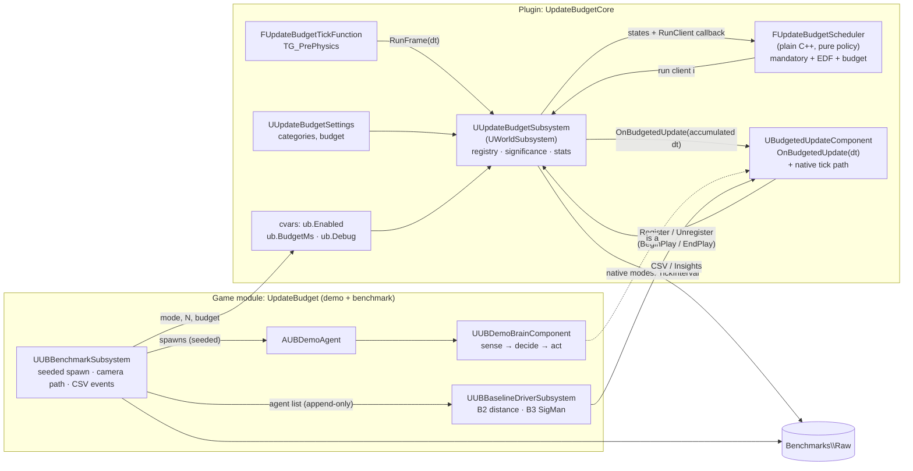
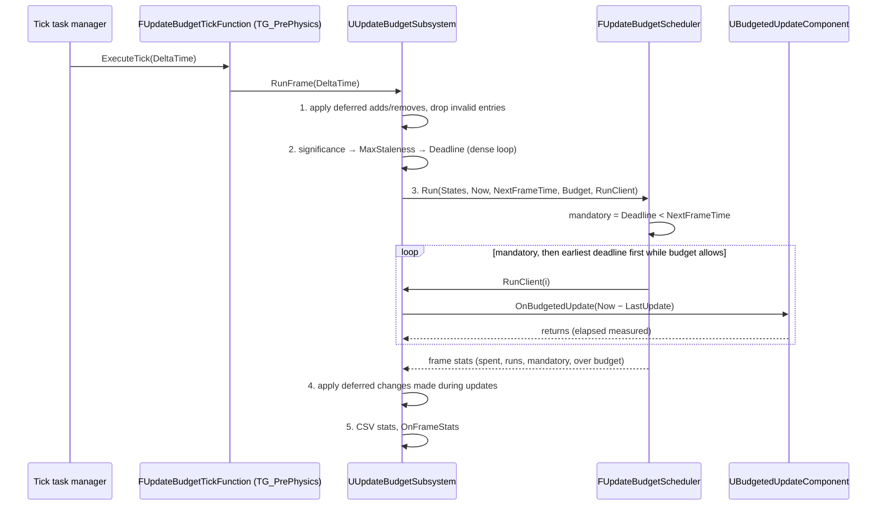

# 02 · System Architecture: UpdateBudget (v1.0, final)

**Phase:** 3 (Architecture), **final**, 2026-11-20. It replaces the initial draft from Step 0, whose changes are listed in §13.
**Engine:** UE 5.8.4. Every engine behaviour relied on here is verified in [01b_Research_Findings.md](01b_Research_Findings.md); references like `01b #3` point to its §1 table.
**Rule:** this is the design *before* code (Phase 3). If implementation proves a decision wrong, this file is updated in the same step.

---

## 1. Goals and non-goals

**Goals**
1. Keep the game-thread time spent on budgeted gameplay updates near a configured ms budget.
2. Spend that budget where it matters: significant agents are allowed less staleness.
3. **Hard guarantee:** no agent goes un-updated for longer than its staleness limit plus one frame.
4. Give each update the **accumulated** delta since its last update, matching what the engine gives interval ticks (`01b #4`).
5. Switch live between native ticking and budgeted ticking **in the same build**, with an identical workload.
6. Keep the core reusable (a plugin) and its scheduling logic **testable without a world**.

**Non-goals (v1)**
- Replacing Mass (that is P9).
- Running gameplay logic on worker threads.
- Budgeting animation (the Animation Budget Allocator does that).
- Dedicated-server relevance from many player views (a growth path, §11).
- Respecting per-actor tick prerequisites (a documented limit, §12).

## 2. The core idea in plain words

Every registered agent has a **deadline**: the latest time it may next be updated.

```text
Deadline = LastUpdateTime + MaxStaleness(Significance)
```

- **Significance** comes from distance and view direction. A near, visible agent gets `MaxStaleness ≈ 0`, so its deadline is always *now*. A far agent gets up to 0.5 s.
- **Every frame:**
  1. Run every agent whose deadline falls before the next frame. These are **mandatory**: this is the no-starvation guarantee, and it beats the budget.
  2. Then run the rest in **earliest-deadline-first** order until the predicted cost of the next update would exceed the remaining budget.

Earliest-deadline-first (EDF) is a classic real-time scheduling rule. Our case fits **Jackson's rule**: all work is available at the start of the frame, and updates are not interrupted part-way. In that case, running jobs in deadline order minimises the worst lateness of any job. This is the textbook result that justifies the choice. The budget cut-off is our own addition, and the measurements (SC1–SC3) show how it behaves.

**Rejected alternatives:**

| Alternative | Why we rejected it |
|---|---|
| Sort by significance only | Far agents starve forever under load |
| Round-robin | Ignores relevance: a guard in your face waits its turn |
| Hand-tuned priority = significance × age | Works, but needs extra weights to tune. EDF gives one meaning to significance: "how long may this wait?" |

## 3. Modules and where they live

```text
D:\UNREAL PORTFOLIO\P01_UpdateBudget\UpdateBudget\          ← the UE project
├── UpdateBudget.uproject
├── Source\UpdateBudget\{Public,Private}\                    ← game module: demo + benchmark only
├── Plugins\UpdateBudgetCore\Source\UpdateBudgetCore\{Public,Private}\   ← the reusable system
└── Config\  Content\
D:\UNREAL PORTFOLIO\P01_UpdateBudget\Tools\                  ← Python stats + run scripts (not part of the UE project)
```

| Module | Type | Responsibility | Depends on |
|---|---|---|---|
| `UpdateBudgetCore` (plugin) | Runtime | Scheduling policy, registry, tick function, settings, cvars, telemetry | `Core`, `CoreUObject`, `Engine`, `DeveloperSettings` |
| `UpdateBudget` (primary game module) | Game | Demo agents, workload spawner, baseline drivers (B2/B3), benchmark director | `UpdateBudgetCore`, `SignificanceManager` (B3 only) |
| `Tools\` | Python | CSV statistics (median, p95, p99), correctness comparison, run orchestration | — |

**The dependency rule:** game → plugin, never the reverse. The plugin knows nothing about agents, baselines or benchmarks.

**Naming:** the plugin is `UpdateBudgetCore` because module names must be unique ([research/04](Research/04_local_engine_verification.md) §0). Public headers use 5.8's export convention: `#define UE_API UPDATEBUDGETCORE_API` … `#undef UE_API` (`01b` §3).

## 4. Classes

### 4.1 Plugin `UpdateBudgetCore` (6 pieces, each with a reason)

| Class | Kind / base | Responsibility | Why it exists, and what we rejected |
|---|---|---|---|
| `FUpdateBudgetScheduler` | Plain C++ struct (no UObject) | The **policy**: given client states, the time, the budget and a "run client *i*" callback, it decides who runs and returns frame stats | Makes the algorithm **unit-testable with fake clients and fake costs, without a world**. *Rejected:* logic inside the subsystem, which can only be tested in a running world |
| `FBudgetClientState` | Plain struct | The hot data per client: `LastUpdateTime`, `Deadline`, `MaxStaleness`, `CategoryIndex` | The per-frame loop walks this dense array and touches no UObject memory (H5) |
| `UUpdateBudgetSubsystem` | `UTickableWorldSubsystem` | The **mechanism**: registry, significance refresh, owning the tick function, running the scheduler, telemetry, mode switching | Its lifetime is the world. Its own `Tick` runs after `TG_PostPhysics` (`01b` §2), which is the right moment to publish one frame's complete telemetry. Scheduling uses the separate `TG_PrePhysics` tick function below. *Rejected:* a manager Actor (can be deleted or duplicated); `UGameInstanceSubsystem` (outlives worlds) |
| `FUpdateBudgetTickFunction` | USTRUCT deriving `FTickFunction`, with `WithCopy = false` | Calls `Subsystem->RunFrame(DeltaTime)` in **`TG_PrePhysics`** | `UTickableWorldSubsystem` ticks after `TG_PostPhysics` and can't choose a group (`01b` §2). Mass uses this same pattern ✔ |
| `UBudgetedUpdateComponent` | `UActorComponent` | The client. It holds the category, registry index and last update time, and declares `virtual void OnBudgetedUpdate(float DeltaSeconds)`. It also has a **native-tick path** for the baselines. It **owns the time contract**: `DeltaSeconds` = world time since its previous update (0 on the first), measured the same way in every mode; the engine's tick `DeltaTime` is not forwarded | A component, not an interface: it must hold data and attach to any actor, Blueprint actors included. *Rejected:* an interface (every class re-implements the bookkeeping); a per-actor delegate (binding plus indirect-call cost in the hot loop) |
| `UUpdateBudgetSettings` + `FUpdateBudgetCategory` | `UDeveloperSettings` (`config=Game, defaultconfig`) + USTRUCT | Project Settings: budget ms, tick group, categories (near/far distance, near/far max staleness, behind-camera multiplier) | One config-backed, designer-editable place. *Rejected:* `UDeveloperSettingsBackedByCVars`, whose sync is editor-only (`01b #11`); Data Assets, which add a loading step for no gain yet |

**Console variables** (`ECVF_Default`, because cheat flags can't be set from config, `01b #11`):

| Cvar | Meaning |
|---|---|
| `ub.Enabled` | `0` native, `1` budgeted |
| `ub.BudgetMs` | Override the settings value; `<0` means use the settings value |
| `ub.Debug` | Debug draw and on-screen stats |

**Telemetry:**
- A stats group `STATGROUP_UpdateBudget` with cycle stats.
- A CSV category `UpdateBudget` with: `UpdateMs`, `UpdatesRun`, `MandatoryRuns`, `OverBudget`, `MaxGapMs`, `NearMaxGapMs`, `Clients`.
- One native multicast delegate `OnFrameStats`, for the debug HUD.

### 4.2 Game module `UpdateBudget` (4 classes)

| Class | Base | Responsibility |
|---|---|---|
| `AUBDemoAgent` | `AActor` | A mesh plus one brain component. Nothing else |
| `UUBDemoBrainComponent` | `UBudgetedUpdateComponent` | The workload: sense (distance and cone vs player) → decide (patrol/alert/return state machine) → act (move along a patrol loop driven by **accumulated patrol time**, so the correct position is known exactly) → a calibrated compute step |
| `UUBBaselineDriverSubsystem` | `UTickableWorldSubsystem` (Game/PIE) | Baselines B2 (distance → `TickInterval`) and B3 (Significance Manager → `TickInterval`), selected with `-UBBaseline=B2\|B3`. Ticks right after the benchmark subsystem (`InitializeDependency`), adopts its agents by index (the agent list is append-only), and maps both baselines through **one shared band test**. **Times its own work** (`Register`, `Retune`) and counts interval changes, to test H6 (S3) |
| `UUBBenchmarkSubsystem` | `UWorldSubsystem` (Game/PIE) | The benchmark director. Reads `-UB…=` values and spawns N agents from a fixed seed (deferred spawn, so the patrol is set before `BeginPlay`). From S2: moves the camera along a fixed analytic path, triggers the doubling wave, fires `CSV_EVENT(BenchStart)` after warm-up, writes CSV metadata and dumps final positions. **Changed in S1:** the project has no hand-authored map, so nothing would place a director or spawner actor. A world subsystem has exactly the right lifetime and replaces both planned actors |

## 5. Overview diagram



## 6. Per-frame flow



### Policy, in code-sized pseudocode (the real code mirrors this)

```text
mandatory = { i : Deadline[i] < NextFrameTime }        // waiting a frame would break the bound
for i in mandatory:          Spent += RunClient(i)     // always; may overrun → counted
rest = others sorted by Deadline ascending              // v1: full sort; Phase 8 may replace with data
for i in rest:
    if Spent + Predicted[Category[i]] > Budget: break   // don't start work that won't fit
    Spent += RunClient(i); update Predicted (EWMA)       // like the ABA's smoothed work-unit cost
```

`NextFrameTime = Now + DeltaTime`. The last frame's delta is used as the estimate. In fixed-step runs it is exact.

## 7. Defaults and why

| Setting | Default | Reasoning |
|---|---|---|
| `BudgetMs` | 2.0 ms | About 12% of a 60 fps frame (16.67 ms), leaving room for physics, animation and UI. The benchmark sweeps 1, 2 and 4 ms |
| Near / far distance | 15 m / 60 m | The demo arena scale. Tunable per category |
| Near max staleness | 0 s | What the player is looking at never stutters |
| Far max staleness | 0.5 s | Within human-like reaction times; usually invisible at distance. Expressed in **seconds**, so it doesn't depend on frame rate (`01b` §5) |
| Behind-camera multiplier | 0.5 on significance | Behind-camera agents may be staler, but are not frozen |
| Tick group | `TG_PrePhysics` | The same group as the native baseline component (`01b #1`) |
| Cost smoothing | EWMA α = 0.2 | Reacts within a few frames without jitter. Measured and revisited in Phase 8 |

## 8. Lifetime and safety rules

| Risk | Rule | Evidence |
|---|---|---|
| The tick function runs in editor worlds | `DoesSupportWorldType`: Game and PIE only. Register in `OnWorldBeginPlay` | `01b #2` |
| The tick function outlives the subsystem | Unregister explicitly in `Deinitialize` (the destructor also unregisters, as a safety net) | `01b` §2 |
| A component is destroyed but its reference is still non-null | Unregister in `EndPlay`. `IsValid()` guard in `RunFrame`. Null entries compacted | `01b #8` |
| A component is added or destroyed **during** another update | An `bIsRunning` flag defers both; they are applied after the loop. Index stability during the loop | `01b #9` |
| Registration before the subsystem exists | Can't happen: `OnWorldBeginPlay` runs before any actor's `BeginPlay` | `01b #7` |
| The Significance Manager is missing in `Initialize` (B3), and is gone by `Deinitialize` | The B3 driver checks for it in `OnWorldBeginPlay`. It unregisters each agent in `HandleAgentEndPlay` (bound to the agent's `OnEndPlay`) and everything left in `OnWorldEndPlay`, while the manager still exists | `01b #10`; `06` §17 |
| A hot loop touching UObjects | Policy loops read only `FBudgetClientState`. UObjects are touched only for chosen updates and significance (owner location) | H5 |

**Registry layout:** two parallel arrays with the same index.
- `UPROPERTY() TArray<TObjectPtr<UBudgetedUpdateComponent>> Clients` is visible to GC.
- `TArray<FBudgetClientState> States` is the hot data.

Each component stores its `RegistryIndex`, so unregister is an O(1) swap-remove. Removal is deferred while running.

## 9. One logic path for every configuration

The workload must be identical across B0–B3 and UB. So **the same `OnBudgetedUpdate` runs in every mode**; only the caller changes.

| Config | Who calls `OnBudgetedUpdate` | Set by |
|---|---|---|
| B0 | The component's own native tick, every frame (`TG_PrePhysics`) | `ub.Enabled 0` |
| B1 | Same as B0, with `tick.AllowBatchedTicks 1` | engine cvar |
| B2 | Native tick with a distance-based `TickInterval` | `UUBBaselineDriverSubsystem` |
| B3 | Native tick with a Significance-Manager-driven `TickInterval` | `UUBBaselineDriverSubsystem` |
| UB | The scheduler; native tick disabled | `ub.Enabled 1` |

**Measuring staleness in every mode, at equal cost:** each call records `gap = Now − LastUpdateTime` into the subsystem's per-frame maximum, published once per frame as the CSV stat `UpdateBudget/MaxGapMs`. The capture keeps every frame, so the full distribution comes from the CSV (the in-game histogram of the first draft was dropped as redundant, S1). This happens in every mode, so the cost is identical. At the end of a run, the director checks every agent's current age once, which catches anything never updated. There is no per-frame all-agents loop in the native modes, so the baselines aren't burdened.

## 10. C++ vs Blueprint

| C++ | Blueprint |
|---|---|
| Everything measured: policy, registry, tick function, significance, telemetry, the demo brain | Optional `BlueprintImplementableEvent ReceiveBudgetedUpdate` for prototyping (the last implementation step, with its VM cost measured); settings editing; the debug widget |

## 11. How it grows into a production game (not built now)

- **Dedicated server:** significance from all players' views. The subsystem takes a list of viewpoints, like `USignificanceManager::Update(TArrayView<const FTransform>)`.
- **Per-platform budgets:** device profiles and scalability groups set `ub.BudgetMs`.
- **One frame budget with animation:** feed our spent time to the Animation Budget Allocator through `AddExternalAnimationTimeSpentThisFrame` (verified in 5.8.4). Measure first.
- **Parallel significance:** `FBudgetClientState` is plain data, so `ParallelFor` is safe for the scoring step (owner locations are cached first).
- **Behavioural LOD:** categories choose a *cheaper update function* per significance band, not just a lower rate.
- **Reuse in later projects:** P2 registers pooled actors, P7 runs squad brains through it, and P10 adds a validator for "ticking actor not registered with the budget".

## 12. Known limits (stated, not hidden)

1. **The budget is soft.** One slow update can overrun it; prediction reduces this, and SC1 counts it.
2. **Mandatory updates can exceed the budget.** If every agent is near and visible, the frame pays. That is deliberate (correctness first), and it is reported.
3. **No tick prerequisites** for scheduled clients. Actors that need them stay on native tick.
4. **Logic must tolerate variable delta.** Per-frame physics forces and frame-counting timers don't fit (`07_Common_Mistakes.md`).
5. **Significance reads each owner's location every frame.** That is pointer-chasing (H5). Caching every K frames is a Phase 8 option, decided with data.
6. **v1 uses a full sort.** O(N log N) per frame is measured at N = 4,000 before anything smarter replaces it.

## 13. Changes from the initial draft (2026-11-19 → 2026-11-21)

| Change | Why |
|---|---|
| Priority formula replaced by **deadlines + EDF** | One meaning for significance; no extra weights; a classic, defensible algorithm |
| Added `FUpdateBudgetScheduler` (pure policy struct) | Unit tests without a world |
| Game module renamed `P01Demo` → `UpdateBudget`; plugin → `UpdateBudgetCore` | Folder layout and unique module names |
| Native baseline tick pinned to `TG_PrePhysics` | Components default to `TG_DuringPhysics` (`01b #1`) |
| Register in `OnWorldBeginPlay`; Game/PIE only; explicit unregister | Custom ticks start immediately, and subsystems exist in editor worlds (`01b #2`) |
| Deferred add/remove plus `IsValid` guard | Components can change mid-update; GC nulls only at GC time (`01b #8–9`) |
| Staleness recorded per update in every mode; end-of-run age check | Fair, equal measurement cost across configurations |
| Cvars `ECVF_Default` plus command-line values | Cheat cvars can't be set from config (`01b #11`) |
| Animation Budget Allocator credited as the model (smoothed cost, accumulated delta) | Prior-art accuracy (`01b #12`) |
| Headline builds use packaged **Development**, not Test (Phase 4) | The launcher engine can't build Test (`09` F-3a) |
| Director and spawner actors → one `UUBBenchmarkSubsystem` (S1) | No hand-authored map, so nothing would place the actors; one class fewer |
| `UUpdateBudgetSubsystem` is a `UTickableWorldSubsystem` (S1) | Its post-physics `Tick` publishes complete per-frame telemetry |
| The base component owns the time contract; the engine tick `DeltaTime` is ignored (S1 code review) | One clock in every mode: native and budgeted updates get identical delta semantics, and SC6 becomes well defined |
| Per-update counters are plain fields, published to CSV once per frame (S1) | The CSV profiler's own benchmark shows about 50 ns per `CSV_CUSTOM_STAT`; per update that would be about 0.2 ms per frame at N = 4,000 |
| Staleness histogram dropped; the per-frame max gap is the CSV stat (S1) | The CSV already keeps every frame; a second copy would cost memory and code for no new information |
| The baseline driver is a `UTickableWorldSubsystem` that ticks after the benchmark subsystem (S3) | Wave agents are adopted on the frame they spawn, the same way in every build |
| View source for B2/B3 is the player camera manager (S3) | The brains sense from the same camera, so every consumer sees the identical view |
| B2 and B3 share one band test (`BandForDistanceSquared`); B3 maps significance back through `BandForSignificance` (S3 simplify) | The two baselines put every agent in the same band by construction, not by floating-point luck |
| B3 touches a component only when its band changes (old vs new significance, S3 simplify) | A competent Significance Manager user would do this; the baseline must not be a strawman |
