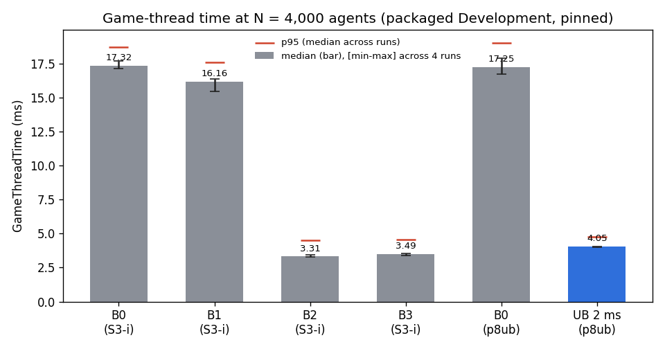
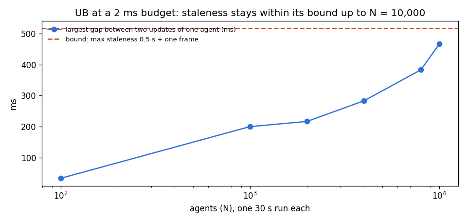

# P01 · UpdateBudget: a frame-time budget for gameplay logic

**Author:** Krish Gangani · [github.com/KrishGangani](https://github.com/KrishGangani)

**Domain:** Performance & profiling · game-thread CPU · **Difficulty:** ★★★☆☆ · **Engine:** UE 5.8.4

> **Status: complete (v1).** Results below are measured; criteria that were not measured are marked so. Not production-ready: a portfolio prototype, measured on one machine.

| Phase | 1 Problem | 2 Research | 3 Architecture | 4 Foundation | 5 Implementation | 6 Explanation | 7 Testing | 8 Profiling | 9 Review | 10 Portfolio |
|---|---|---|---|---|---|---|---|---|---|---|
| State | ✓ | ✓ | ✓ final | ✓ | ✓ (S1–S8) | ✓ | ✓ | ✓ (partial) | ✓ | ✓ |

---

## Problem statement

Thousands of ticking actors cost the same game-thread time whether or not they matter to the player. A static `TickInterval` doesn't react to load, so frame time grows with actor count. Details: [Explanation/01_Problem_Analysis.md](Explanation/01_Problem_Analysis.md).

## Engineering approach

Each agent gets a deadline from its significance: near and visible means "update now", far means "up to 0.5 s". Each frame a scheduler runs every agent that would otherwise miss its deadline, then the rest in earliest-deadline-first order while a measured millisecond budget lasts. Each update receives the accumulated delta time. The model is adapted from Epic's Animation Budget Allocator (skeletal meshes only) to general gameplay logic, with the staleness bound in seconds rather than frames. It is compared against native tick, engine tick batching, distance-based intervals and the Significance Manager. Details: [Explanation/02_System_Architecture.md](Explanation/02_System_Architecture.md).

## Architecture diagram

Final (v1.0): [Explanation/02_System_Architecture.md](Explanation/02_System_Architecture.md) §5–6. A rendered version is in [Media/architecture_v1.html](Media/architecture_v1.html)

## Before / after comparison

Five configurations on one fixed workload (02 §9): **B0** native tick every frame, **B1** B0 with engine tick batching, **B2** distance bands → `TickInterval`, **B3** Epic's Significance Manager → `TickInterval`, **UB** UpdateBudget at its default 2 ms budget. Packaged Development build, fixed 60 Hz step, every run pinned to the performance cores; median of 4 interleaved runs, [min–max across runs].

| N = 4,000 | GameThreadTime median (ms) | p95 (ms) | Batch |
|---|---|---|---|
| B0 native tick | 17.25 [16.74–17.89] | 19.03 | `2026-11-21_100316_p8ub` (balanced with UB) |
| **UB, 2 ms budget** | **4.05 [3.99–4.05]** | **4.77** | `2026-11-21_100316_p8ub` |
| B1 batched ticks | 16.16 [15.48–16.35] | 17.59 | `2026-11-21_015041_baseline_pinned` (S3) |
| B2 distance bands | 3.31 [3.26–3.42] | 4.51 | `2026-11-21_015041_baseline_pinned` (S3) |
| B3 Significance Manager | 3.49 [3.37–3.54] | 4.56 | `2026-11-21_015041_baseline_pinned` (S3) |

**What this shows, honestly:**
- UB cuts B0's game-thread time at N = 4,000 by about 4× (17.25 → 4.05 ms), measured in one balanced batch.
- UB does **not** beat the smarter native baselines at its default 2 ms budget: B2 and B3 are about 0.6–0.7 ms faster at the median. UB spends its whole budget on purpose (work-conserving, 02 §12 item 9), so it updates agents more often than B2/B3 do. The budget sweep that would find the budget where UB matches or beats them was not run, and the B2/B3 numbers come from an earlier batch with an older build. **SC4 is therefore not met as measured.**
- What UB gives that B2/B3 don't: a **hard staleness guarantee** (no agent ever waited longer than its limit in any run) and a **controlled budget** (p95 of the update cost at exactly 2.00 ms in every run).

## Benchmark results

The success criteria were fixed before the code ([01 §6.4](Explanation/01_Problem_Analysis.md)); the full table, with the batches, is in [09, Phase 8](Explanation/09_Testing_And_Benchmarks.md).

| Criterion | Result |
|---|---|
| SC1 budget adherence (p95 update time ≤ 1.10 × budget) | **PASS** in every UB run (p95 2.000–2.001 ms at 2 ms; every over-budget frame soft, none forced) |
| SC2 no starvation (0 staleness violations) | **PASS**: 0 violations in every UB run, N = 100 to 10,000, including a 30-minute soak and 11 live mode switches |
| SC3 relevance first (near agents updated every frame in ≥ 99% of frames) | **PASS**: 100% in every UB run |
| SC4 real improvement over the best of B0–B3 | **Not met** at the default 2 ms budget (see above); the budget sweep was not run |
| SC5 low overhead at N = 100 | **Not measured** (no pinned B0 run at N = 100 beside UB) |
| SC6 behaviour stays correct (patrol error) | **Not measured** |
| SC7 editor and spawn cost | **Not measured** |

The staleness bound holds up to N = 10,000 (one functional run per N): the budget allows about 495 updates per frame whatever N, so the largest gap grows towards the bound while mandatory updates keep it under. Raw data and run logs: [Benchmarks/](Benchmarks/README.md).

## Recorded demonstration

Not recorded (skipped by the owner's decision). The debug view (`ub.Debug 2`) tints every agent by how recently it was updated ([08](Explanation/08_Debugging_And_Profiling.md)).

## Source code

The UE project is in [UpdateBudget/](UpdateBudget/) (UE 5.8.4, C++):
- the reusable system is the plugin `UpdateBudgetCore`;
- the demo and benchmark code is in the game module `UpdateBudget`.

## Documentation

| File | Contents |
|---|---|
| [00_Project_Overview](Explanation/00_Project_Overview.md) | Identity, demonstration, presentation, industry relevance |
| [01_Problem_Analysis](Explanation/01_Problem_Analysis.md) | Problem, existing work, root-cause hypotheses, success criteria, measurement plan |
| [01b_Research_Findings](Explanation/01b_Research_Findings.md) | Phase 2: verified engine behaviour (UE 5.8.4) and what it changed in the design |
| [02_System_Architecture](Explanation/02_System_Architecture.md) | Final v1.0: modules, classes, deadline + EDF scheduling, data flow, safety rules, rejected alternatives |
| [03_Implementation_Roadmap](Explanation/03_Implementation_Roadmap.md) | The small, ordered build steps; baselines captured before scheduler code |
| [04](Explanation/04_CPP_Fundamentals.md) · [05](Explanation/05_Line_By_Line_Code_Explanation.md) · [06](Explanation/06_Unreal_APIs_And_Macros.md) · [07](Explanation/07_Common_Mistakes.md) | C++ fundamentals, line-by-line code (by file, as the code is now), APIs and macros, common mistakes (by module). Consolidated and re-checked against 5.8.4 in Phase 6 |
| [09](Explanation/09_Testing_And_Benchmarks.md) | Every check and benchmark batch so far, with its raw-data batch name |
| [08](Explanation/08_Debugging_And_Profiling.md) · [10](Explanation/10_Interview_Questions.md) · [11](Explanation/11_Optimization_Decisions.md) · [12](Explanation/12_Future_Scalability.md) | Debugging and profiling (every tool that exists; profiling results in Phase 8), interview questions, optimisation decisions (candidates so far), future scalability (growth paths so far). Completed in Phases 8–10 |
| [Research/](Explanation/Research/) | The portfolio-wide research this project draws on: job market, technical challenges, existing solutions, local engine verification |

## License

MIT, see [LICENSE](LICENSE). Unreal Engine itself is not included and is covered by Epic Games' own license.
